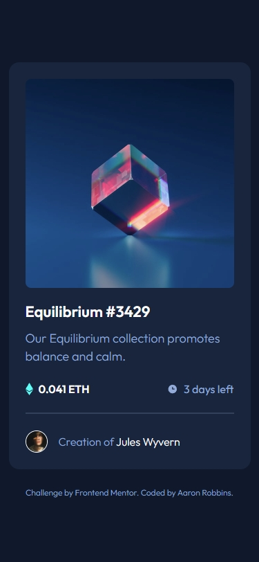
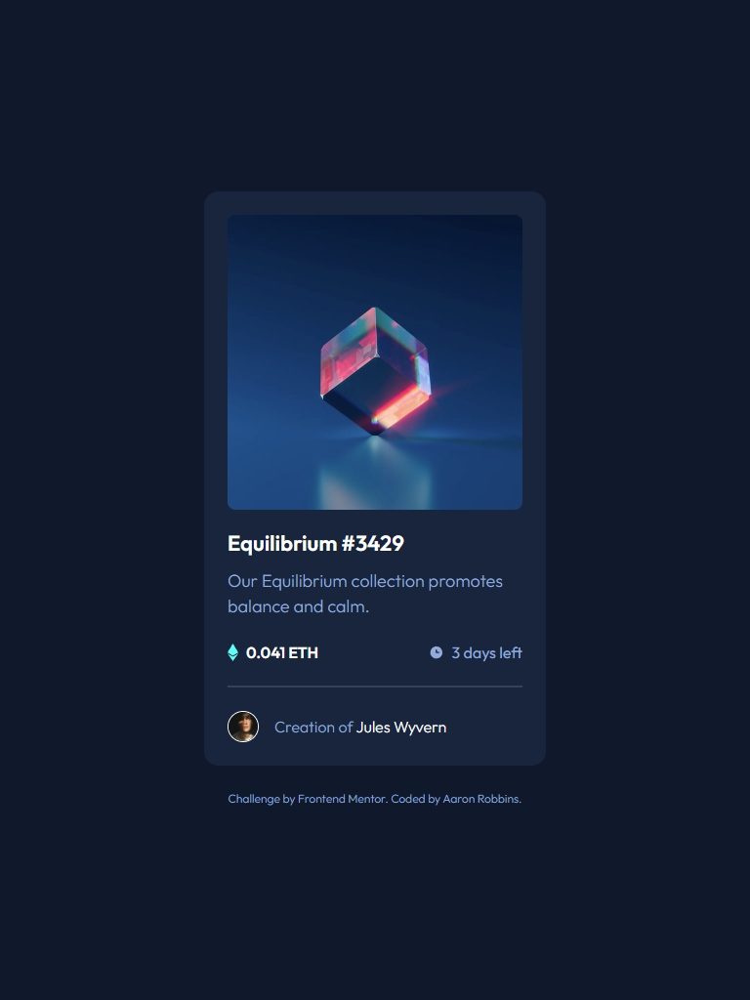
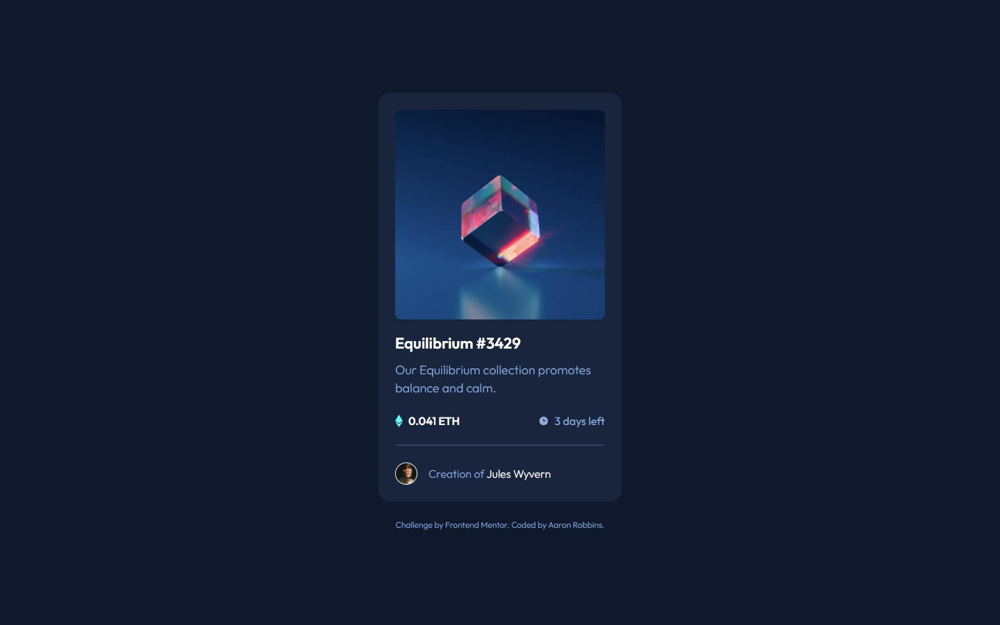
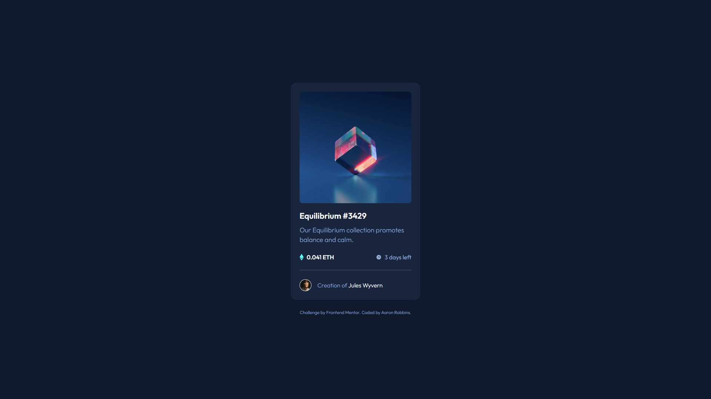

# Frontend Mentor - NFT preview card component solution

This is a solution to the [NFT preview card component challenge on Frontend Mentor](https://www.frontendmentor.io/challenges/nft-preview-card-component-SbdUL_w0U). Frontend Mentor challenges help you improve your coding skills by building realistic projects.

## Table of contents

- [Overview](#overview)
  - [The challenge](#the-challenge)
  - [Screenshot](#screenshot)
  - [Links](#links)
- [My process](#my-process)
  - [Built with](#built-with)
  - [What I learned](#what-i-learned)
  - [Continued development](#continued-development)
  - [Useful resources](#useful-resources)
- [Author](#author)
- [Acknowledgments](#acknowledgments)

## Overview

### The challenge

Users should be able to:

- View the optimal layout depending on their device's screen size
- See hover states for interactive elements

### Screenshot






### Links

- [Solution URL](https://www.frontendmentor.io/solutions/nft-preview-card-using-vanilla-css-RH9V5yIXSt)
- [Live Site URL](https://freexm1nd.github.io/nft-preview-card-component/)

## My process

### Built with

- Semantic HTML5 markup
- CSS custom properties
- Flexbox
- CSS Grid
- Mobile-first workflow

### What I learned

This was a nice, easy, refresh challenge for me. Didn't take me long to complete. It was nice to come back to something a bit more relaxing that didn't take much effort. I did add transitions to a design for the first time outside of a bootcamp, and I learned how it's utilized in CSS.

To see how you can add code snippets, see below:

```html
<div class="nft-image__overlay">
  
</div>

```

```css
.nft-image {
  height: var(--nft-image-size);
  border-radius: var(--nft-image-border-radius);
  margin-bottom: var(--spacing-24);
}

.nft-image__overlay {
  position: absolute;
  display: flex;
  justify-content: center;
  align-items: center;
  opacity: 0;
  width: var(--nft-image-size);
  height: var(--nft-image-size);
  border-radius: var(--nft-image-border-radius);
  transition: all 0.3s ease-in-out;
}
.nft-image__overlay:hover {
  opacity: 1;
  background-color: var(--cyan-hover);
}
```

### Continued development

I want to continue using transitions in my challenges. It'll help me make more appealing and interactive projects in the future.

### Useful resources

- [MDN](https://developer.mozilla.org/en-US/docs/Web/CSS/Reference/Properties/transition) - I used MDN to look up how to use transitions.

## Author

- GitHub - [Aaron Robbins](https://github.com/FREExM1ND)
- Frontend Mentor - [@FREExM1ND](https://www.frontendmentor.io/profile/FREExM1ND)

## Acknowledgments

I'm thankful for the team at Responsively for creating a useful development tool.

Thank you to Frontend Mentor for the challenge. I'm eager to do more.
